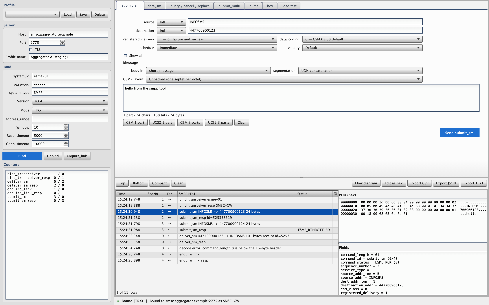
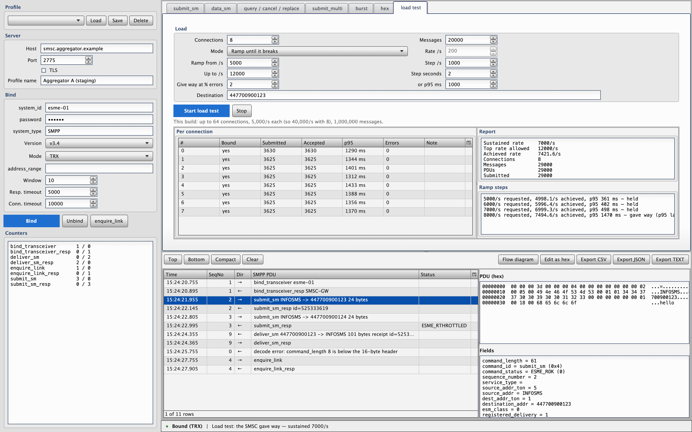
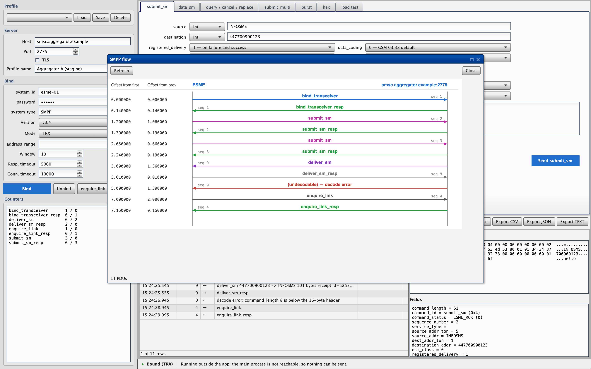

# SMPP Tool

A desktop SMPP client for testing SMSCs and SMS aggregators. It sends what you
type, shows what came back, and never tidies either up.



Rust backend, [Tauri](https://tauri.app) shell, [qooxdoo](https://qooxdoo.org)
interface. The macOS build is 19 MB.

---

## What it is for

Pointing at an SMSC or an aggregator and finding out what it really does —
which is rarely what its documentation says. So the rules are:

**Never hide the bytes.** Every PDU is in the trace with its exact hex, its
decoded fields, and the status name. Click a row and you see both.

**Never block invalid input.** An over-long `source_addr`, a `data_coding` the
spec does not list, a `command_length` of `0xdeadbeef`, a body that overruns
`sm_length` — all of it goes on the wire exactly as typed. You get a warning,
never a refusal. Making an SMSC misbehave is the point.

**Never lose traffic.** A malformed PDU does not take the good ones that shared
its read. The burst result table is never capped. The trace is capped and says
so when it starts discarding.

**Never reconnect behind your back.** A lost bind is reported and stays lost
until you say otherwise. No retries you did not ask for.

## What it does

**Every PDU the protocol defines.** `submit_sm`, `data_sm`, `submit_multi`,
`query_sm`, `cancel_sm`, `replace_sm`, the SMPP 5.0 broadcast family, and a hex
composer for anything else — including PDUs that will not decode.

**Text that behaves like text.** GSM 03.38 with the escape table, UCS2,
Shift-JIS and the rest, packed or unpacked septets. Concatenation by UDH or by
`sar_*` TLVs. A live counter that agrees with the segmenter by construction,
because both ask the same backend.

**Delivery receipts, correlated.** By `receipted_message_id`, by the `id:` in
the receipt text, with the decimal/hex reading tried both ways and leading
zeros stripped — because aggregators disagree about all of this. A receipt that
arrives before its own response is still matched.

**Bursts.** N messages to a range, a repeated number or a CSV, at a rate you
set, with a row per message: the id, the status, the submit latency, the
receipt and its latency. Exportable as CSV.

**Load tests.** Up to 64 connections binding in parallel, messages spread
across them, at a fixed rate or on a ramp that climbs until the SMSC gives way.
The report leads with the rate it sustained — which is a different number from
the rate you asked for and from the rate you achieved, and the only one that
answers "what does this thing take".



**TLS**, with your own CA and client certificate, or with verification off for
a server whose certificate you do not have.

**A flow diagram**, one arrow per PDU with both time offsets, for showing
somebody what happened.



## Install

Take the file for your machine from
[Releases](../../releases): a `.dmg` for macOS, an `.AppImage` or `.deb` for
Linux, an `.msi` or `.exe` for Windows.

Nothing is code-signed, so the first launch needs a nudge: on macOS right-click
the app and choose Open; on Windows choose "More info" then "Run anyway".

## Build it yourself

You need [Rust](https://rustup.rs) and Node 20+. On Linux you also need the
webview: `libwebkit2gtk-4.1-dev librsvg2-dev patchelf libxdo-dev libssl-dev`.

```bash
npm ci
npm run tauri:build     # the installer for this machine
npm run tauri:dev       # or just run it
```

## Run the tests

```bash
npm test                        # the renderer: types and 206 tests

npm run build:ui                # the backend suite checks the built frontend
cd src-tauri && cargo test      # the backend: 405 tests
```

The protocol tests build their inputs from hand-written bytes rather than from
the encoder, because a codec that agrees with itself proves nothing. Ten of
them spell out the exact bytes each command family puts on the wire.

A contract test serialises every shape that crosses between the backend and
the interface, and the renderer's suite checks its own declarations against
that file — so renaming a field on one side fails the build until it is renamed
on the other.

## Testing against a real SMSC

Two harnesses run by hand, outside the automatic suite, because a test server
is not something `cargo test` should depend on and credentials do not belong in
a committed test:

```bash
cd src-tauri

# bind, enquire_link, one submit, wait for the receipt, unbind
cargo run --example against_real_smsc -- <host> <port> <system_id> <password>

# a ramp that climbs until the server gives way
cargo run --release --example real_smsc_ramp -- \
  <host> <port> <system_id> <password> \
  [connections] [start/s] [step/s] [max/s] [step_secs] [messages] [window] \
  [error%] [p95_ms]
```

The ramp prints a line per step and tells you which rate held:

```
requested   achieved  accepted   errors      p95  verdict
7000/s       6999.3     14000     0.0%     498ms  held
7500/s       7494.6     15000     0.0%    1470ms  p95 latency reached 1470ms, above the 1000ms allowed

ended: Breached
sustained: 7000/sec
```

That server returned no error at any rate, up to 16000/sec. The latency is
what told the truth — which is why the ramp watches both.

## The screenshots

`tools/screenshots.sh` regenerates them: it serves the built interface, fills
it with plausible traffic through the same stand-in-bridge seam the tests use,
and captures each view with headless Chrome. Nothing in them is drawn by hand,
and nothing touches a socket.

## Layout

```
src-tauri/src/smpp/      the protocol: codec, TLVs, text, segmentation, receipts
src-tauri/src/app/       sockets, session, trace, burst, load test, profiles
src-tauri/src/commands.rs  the Tauri command surface
src/shared/ui/           the renderer's logic, in TypeScript, no codec
src/ui/source/class/     the qooxdoo widgets
```

The protocol layer is hand-written against SMPP 3.4 and 5.0 rather than taken
from a library, because a library validates — it has to — and this tool has to
be able to send a `command_length` that lies. The tables were later checked
against [Rusmpp](https://github.com/Rusmpp/Rusmpp) as a second reading of the
spec, which found two mislabelled TLVs and three gaps.

The interface never builds or parses a PDU. It sends the values you typed and
gets back the PDUs they mean, so there is exactly one place that decides what a
form means.

## Limits

This build will open 64 connections, ask each for 5,000 messages a second, and
run a million messages in one go. A burst holds 50,000 rows at up to 500/sec.
These are guardrails against a typo, not protocol limits, and the app says what
they are rather than making you find out by crossing one.

## Licence

MIT.
